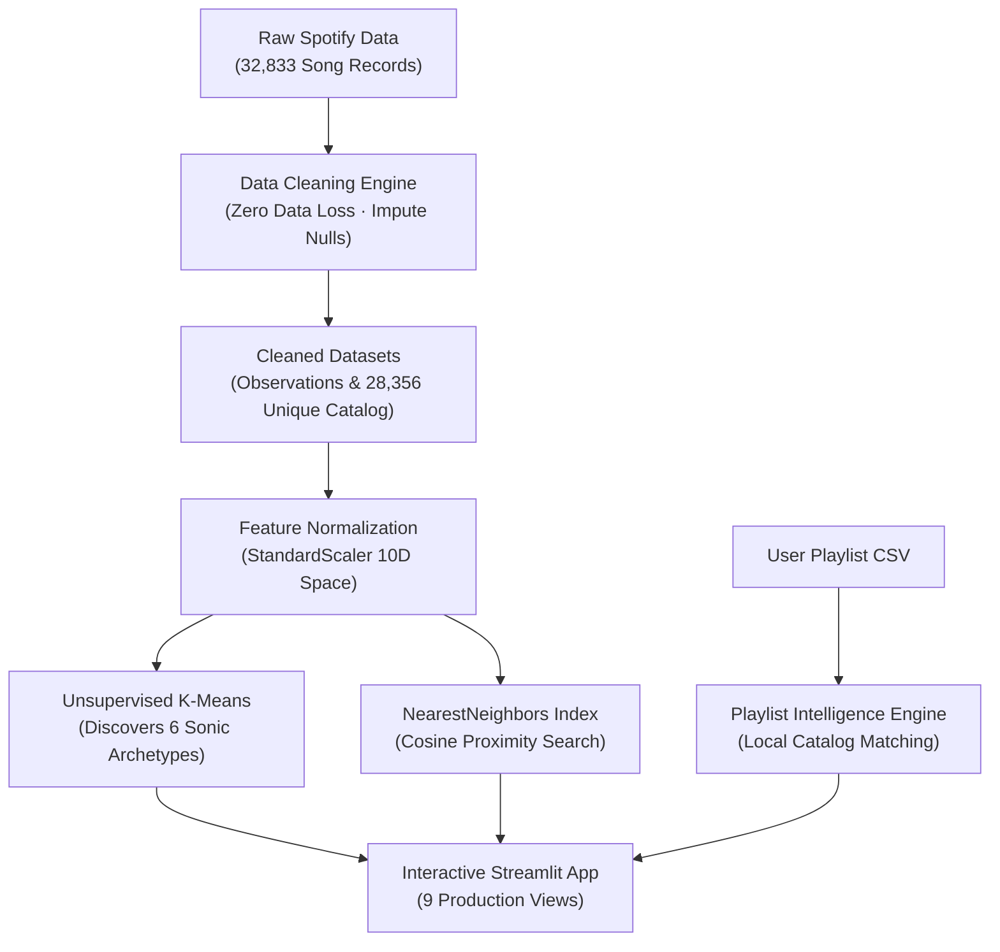

# ◈ SONIC ATLAS — Music Intelligence Platform
### Discovering the Secret Anatomy of Music Through Data Science & Machine Learning

> **A quick note before we start**: *SONIC ATLAS is an independent, educational student and research project built for data science and music analysis. It is not affiliated with, endorsed by, or sponsored by Spotify AB.*

---

## Table of Contents
1. [What is SONIC ATLAS?](#1-what-is-sonic-atlas)
2. [How Does It Work?](#2-how-does-it-work)
3. [What Can You Do With It? (The 9 Application Views)](#3-what-can-you-do-with-it)
4. [Understanding the Music Intelligence (In Plain English)](#4-understanding-the-music-intelligence)
5. [How We Built It (The Technology Stack)](#5-how-we-built-it)
6. [Dataset & Verified Project Numbers](#6-dataset--verified-project-numbers)
7. [How to Run SONIC ATLAS (Beginner's Step-by-Step Guide)](#7-how-to-run-sonic-atlas)
8. [First-Time User Walkthrough](#8-first-time-user-walkthrough)
9. [Understanding the Results & Scores](#9-understanding-the-results)
10. [Project Architecture (Simple Flowchart)](#10-project-architecture)
11. [Testing & Reliability (76 Tests Passing)](#11-testing--reliability)
12. [How Deployment Works (Local & Docker)](#12-how-deployment-works)
13. [Limitations & Honest Boundaries](#13-limitations--honest-boundaries)
14. [Simplified Folder Guide](#14-simplified-folder-guide)
15. [Optional Technical Deep-Dive](#15-optional-technical-deep-dive)
16. [Credits & Conclusion](#16-credits--conclusion)

---

## 1. What is SONIC ATLAS?

Have you ever wondered why two songs from completely different genres sound so great together on the same playlist? 

For example, why does a fast-paced **Rock** anthem like AC/DC's *"Back In Black"* feel just as heart-pumping and intense as an electronic festival **EDM** drop by Martin Garrix? Or why does a mellow **R&B** ballad have the same relaxing vibe as an acoustic **Folk** song?

Traditional music streaming apps usually group songs by **genre labels** (like *"Pop"*, *"Rock"*, or *"Hip-Hop"*). But genre labels are often just marketing tags made up by record companies. They do not tell you what a song actually *sounds* like on the inside.

**SONIC ATLAS** is an interactive web platform that looks past genre labels. Instead of judging songs by their tags, it analyzes the **real acoustic ingredients** of music:
- How fast is the beat?
- How loud is the recording?
- How energetic does it feel?
- Is it played on acoustic guitars or digital synthesizers?
- Is it cheerful and happy, or sad and melancholic?

By analyzing **over 32,000 songs**, SONIC ATLAS groups songs into natural **sonic families** (which we call *Sonic Archetypes*) and helps you discover **"Acoustic Twins"** — songs in completely different genres that share the exact same musical feel.

---

## 2. How Does It Work?

Think of a song like a cooking recipe:
- In cooking, a cake is made of flour, sugar, butter, and eggs.
- In music, a song is made of tempo (speed), loudness, acousticness, energy, and danceability.

Here is the journey every song takes through SONIC ATLAS:

```
┌─────────────────┐       ┌─────────────────┐       ┌─────────────────┐
│  1. RAW DATA    │ ───▶  │ 2. DATA CLEANING│ ───▶  │ 3. ML GROUPING  │
│ 32,833 Spotify  │       │ Fix typos, fix  │       │ K-Means groups  │
│  song records   │       │ missing info    │       │ into 6 families │
└─────────────────┘       └─────────────────┘       └────────┬────────┘
                                                             │
┌─────────────────┐       ┌─────────────────┐                │
│ 5. WEB APP      │ ◀───  │ 4. RECOMMEND    │ ◀──────────────┘
│ Interactive UI  │       │ Find Acoustic   │
│ for you to use! │       │ Twins instantly │
└─────────────────┘       └─────────────────┘
```

1. **We Collect the Song Measurements**: We start with real Spotify acoustic data for 32,833 song entries.
2. **We Clean the Data**: We make sure there are no broken entries, empty fields, or corrupted numbers, without accidentally deleting real songs.
3. **We Group the Songs (Clustering)**: An artificial intelligence algorithm called *K-Means* groups songs into 6 distinct musical families based purely on their sound.
4. **We Match Songs by Similarity**: When you pick a song you love, our system calculates which other songs in the database have the closest acoustic profile.
5. **We Show You Everything on an Interactive Screen**: You can compare tracks on radar charts, upload your own playlists, and explore the catalog through an easy-to-use web dashboard.

---

## 3. What Can You Do With It?

SONIC ATLAS is organized into **nine dedicated screens** (views) accessible directly from the left sidebar. Here is what each screen does and why you would use it:

| # | Screen Name | What It Does | Why You Would Use It |
|---|---|---|---|
| **1** | **Overview** | The platform's front door. Shows total songs, artists, playlists, genres, and project health cards. | To get an instant high-level summary of the entire music library and verify system status. |
| **2** | **Music Explorer** | Lets you inspect the 10 acoustic measurements using interactive histograms, curves, and scatter plots. | To see how loud, fast, or danceable modern music really is, and how features like energy and loudness connect. |
| **3** | **Genre Analysis** | Compares the 6 major genres (EDM, Latin, Pop, R&B, Rap, Rock) across multi-spoke radar charts. | To understand what makes each genre unique (e.g. why Latin music has the highest danceability). |
| **4** | **Data Insights** | Explores how music changed over the decades (1960–2020), top recording artists, and playlist popularity. | To see historical trends, such as how acoustic instruments declined as electronic production rose. |
| **5** | **Cluster Intelligence** | Reveals the **Six Discovered Sonic Archetypes** found by our unsupervised machine learning model. | To explore natural musical families without genre bias, and rotate 2D/3D map projections of the music space. |
| **6** | **Recommendations** | Enter any song and discover its closest acoustic matches using 4 discovery modes and diversity controls. | To find new music that sounds like your favorite track, or discover songs in other genres with the same vibe. |
| **7** | **Track Comparison** | Pick 2 to 5 songs and compare them side-by-side on an interactive spider radar chart and grouped bars. | To settle debates on which song is faster, louder, or more energetic, and see their exact similarity score. |
| **8** | **Playlist Intelligence** | Upload your own playlist CSV file to decode its musical identity and discover new tracks to add to it. | To find out what kind of playlist you built (e.g. *"High-Octane Mainstage"*), check artist diversity, and export reports. |
| **9** | **Catalog Intelligence** | Provides a macro-view heatmap showing how genres overlap, an artist inspector, and multi-filter search. | To inspect an artist's complete acoustic profile (like Queen or Drake) or search for songs matching custom criteria. |

---

## 4. Understanding the Music Intelligence

You don't need a math or engineering degree to understand how SONIC ATLAS works! Here are the core concepts explained with everyday examples.

### A. The 10 Acoustic Features (The "Ingredients" of Music)
Spotify measures every song across continuous acoustic dimensions on a scale from 0.0 to 1.0 (with loudness in decibels and tempo in beats per minute):

- **Energy (0.0 to 1.0)**: How intense, fast, and noisy a track feels. A screaming metal song has energy near `0.95`; a lullaby has energy near `0.10`.
- **Danceability (0.0 to 1.0)**: How easy it is to dance to the song based on tempo stability and beat strength. A steady house beat scores high; freeform jazz scores low.
- **Valence (Musical Mood, 0.0 to 1.0)**: How happy or cheerful the music sounds. High valence sounds euphoric and sunny; low valence sounds sad, moody, or melancholic.
- **Loudness (Measured in decibels, typically -30 dB to 0 dB)**: The overall volume of the recording. `0 dB` is the loudest possible master level; `-20 dB` is soft and quiet.
- **Tempo (Beats Per Minute, BPM)**: The speed of the rhythm. A slow ballad is around `70 BPM`; a driving pop song is around `120 BPM`; fast techno is around `140+ BPM`.
- **Acousticness (0.0 to 1.0)**: How much of the song uses real acoustic instruments (like acoustic guitars, pianos, or violins) rather than electronic synthesizers.
- **Instrumentalness (0.0 to 1.0)**: Whether the track contains vocals. Songs near `0.0` are full of singing; songs near `1.0` have no human vocals at all.
- **Speechiness (0.0 to 1.0)**: How much spoken-word presence exists. Rap and spoken poetry have high speechiness; regular sung pop songs have low speechiness (`< 0.15`).
- **Liveness (0.0 to 1.0)**: Detects whether an audience was present during the recording. A live concert stadium recording scores high (`> 0.60`).
- **Duration (Minutes & Seconds)**: How long the song lasts.

---

### B. What is Data Cleaning?
> *Analogy: Before a chef cooks, they wash the vegetables and throw away spoiled leaves.*

In our dataset of 32,833 entries, exactly 5 rows were missing artist names or song titles. Instead of throwing these songs in the trash, we carefully labeled them as `"Unknown Artist"` and preserved their audio numbers. We also made sure that songs appearing in multiple playlists weren't counted as separate compositions in our recommendation engine.

---

### C. What is Correlation?
> *Analogy: When it rains outside, umbrella sales go up. They move together.*

Correlation measures whether two measurements change together:
- **Positive Correlation (+)**: When one goes up, the other goes up. In our dataset, **Energy and Loudness** have a strong positive correlation ($+0.68$). Louder songs almost always feel more energetic!
- **Negative Correlation (-)**: When one goes up, the other goes down. **Energy and Acousticness** have a strong negative correlation ($-0.54$). Songs played on soft acoustic guitars are rarely loud and aggressive.

---

### D. What is K-Means Clustering?
> *Analogy: Imagine dumping 30,000 colored marbles onto a table and letting magnets group similar colors into 6 bowls.*

**Clustering** is an unsupervised machine learning method. "Unsupervised" means we did **not** tell the computer what genres exist. We simply gave it the 10 audio features and said: *"Find 6 natural groups of songs that share the same sound profile."*

The computer discovered **The Six Sonic Archetypes**:
1. **High-Octane Anthem**: Driving Rock & Festival EDM (loudest, fastest, intense energy).
2. **Instrumental Synth Wave**: Progressive electronic club music (heavy synthesizers, long songs, no vocals).
3. **Live Concert & Stadium Arena**: Live performances with crowd atmosphere and dynamic acoustics.
4. **Rhythmic Groove & Vibrant Pop**: Upbeat dance pop and Latin reggaeton (happy mood, highly danceable).
5. **Lyrical Flow & Urban Hip-Hop**: Rap and trap music with spoken cadence and syncopated beats.
6. **Acoustic Intimacy & Mellow Soul**: Gentle acoustic guitar, piano ballads, and mellow soul.

---

### E. What is PCA (Principal Component Analysis)?
> *Analogy: Holding a 3D toy in front of a flashlight to see its flat 2D shadow on the wall.*

Because humans can only see in 2D or 3D, we cannot directly draw a 10-dimensional chart on a computer monitor. **PCA** is a mathematical technique that flattens 10 features down to 2 or 3 master coordinates while preserving as much of the original information as possible. This lets you see the whole music galaxy on a single screen!

---

### F. What is Cosine Similarity?
> *Analogy: Imagine two compass needles. If both point directly North, the similarity is 1.0 (identical direction). If they point in opposite directions, the similarity is 0.0.*

To see how similar two songs are, we draw an imaginary arrow in 10-dimensional space for each song. **Cosine similarity** measures the angle between those two arrows:
- **1.0000**: Perfect acoustic alignment (the songs sound virtually identical in production and feel).
- **0.9000 to 0.9500**: Very close acoustic twins (matching energy, tempo, and groove).
- **Below 0.7000**: Distinctly different musical styles.

---

### G. What is Content-Based Recommendation?
Unlike Spotify's regular system (which looks at what other users listened to), a **content-based recommendation engine** looks strictly at the song itself. It doesn't care if an artist is famous or who listened to it. If an indie rock song from 1975 has the same beat, energy, and acousticness as a modern 2020 electronic track, SONIC ATLAS connects them as **Acoustic Twins**!

---

## 5. How We Built It

Every tool in our project was chosen for simplicity, speed, and reliability:

- **Python**: The friendly programming language that powers all our data processing and algorithms.
- **Pandas**: A fast data tool that organizes our song numbers like an ultra-powerful spreadsheet.
- **NumPy**: A math library that calculates vector similarity in fractions of a millisecond.
- **Scikit-learn**: The machine learning toolkit that performs our K-Means clustering, scaling, and nearest-neighbor search.
- **Streamlit**: The modern web framework that turns our Python code into an interactive, beautifully styled browser dashboard.
- **Matplotlib & Seaborn**: The charting libraries that draw our polar radar charts, histograms, and heatmaps.
- **Python-pptx**: Generates our professional 18-slide PowerPoint demonstration deck programmatically.
- **Docker**: Packs the entire project into a self-contained container so anyone can run it anywhere without installation headaches.

---

## 6. Dataset & Verified Project Numbers

All numbers in SONIC ATLAS are calculated directly from real data. We never invent statistics:

| Metric | Verified Count | Explanation |
|---|:---:|---|
| **Total Song Observations** | **32,833** | The complete collection of playlist-associated song records. |
| **Unique Track Compositions** | **28,356** | Distinct songs (deduplicated by `track_id` for recommendations). |
| **Distinct Recording Artists** | **10,692** | Singers, bands, and music producers represented. |
| **Curated Playlists** | **449** | Real playlists across 471 unique playlist IDs. |
| **Super Genres** | **6** | EDM, Latin, Pop, R&B, Rap, and Rock. |
| **Subgenres** | **24** | Exactly 4 balanced subgenres per super genre. |
| **Continuous Audio Measurements** | **10** | Danceability, energy, loudness, valence, tempo, etc. |
| **Discovered Sonic Archetypes** | **6** | Discovered purely by unsupervised machine learning. |
| **Natural Cross-Genre Discovery** | **57.33%** | Over half of nearest acoustic matches belong to a different genre! |
| **Automated Tests** | **76 / 76** | All tests passing with 100% success rate in ~3.2 seconds. |

---

## 7. How to Run SONIC ATLAS

You can run SONIC ATLAS on your own computer in just a few minutes. Follow these simple steps:

### Prerequisites
Make sure you have **Python 3.9 or higher** installed on your computer. If you don't have it, download it free from [python.org](https://www.python.org/downloads/).

---

### Step 1: Open Your Terminal or Command Prompt
- **On Mac**: Press `Cmd + Space`, type `Terminal`, and press `Enter`.
- **On Windows**: Press `Win + S`, type `Command Prompt` (or `PowerShell`), and press `Enter`.

### Step 2: Navigate to the Project Folder
Use the `cd` command (which means "change directory") to go into the folder:
```bash
cd "path/to/corizo Ai major project"
```

### Step 3: Activate the Virtual Environment
A virtual environment keeps the project's packages tidy and separate from your other programs:

```bash
# On macOS or Linux:
source .venv/bin/activate

# On Windows:
.venv\Scripts\activate
```
*(You will see `(.venv)` appear at the beginning of your command prompt line).*

### Step 4: Install Dependencies (If Not Already Installed)
```bash
pip install -r requirements.txt
```

### Step 5: Start the Web Platform!
You have two easy ways to launch the app:

**Option A (Standard Python)**:
```bash
streamlit run app.py
```

**Option B (Using npm)**:
```bash
npm run dev
```

### Step 6: View the Platform in Your Browser
Your terminal will print a local address:
```text
Local URL: http://localhost:8501
```
Open your web browser (Chrome, Safari, Edge, or Firefox) and visit `http://localhost:8501`. That's it! SONIC ATLAS is running!

---

## 8. First-Time User Walkthrough

Here is a fun 5-minute tour to try when you open the app for the first time:

```
1. Start at Overview ──▶ 2. Pick a Song in Recommendations ──▶ 3. Switch to Acoustic Twins
        │                                                                │
        ▼                                                                ▼
5. Upload a Playlist in       ◀── 4. Compare Songs Side-by-Side in Track Comparison
   Playlist Intelligence
```

1. **Check Out the Overview**: Notice the top stat cards showing 32,833 observations and verified 100% data integrity.
2. **Go to Recommendations**: Click **Recommendations** in the sidebar. Select a famous benchmark song from the dropdown (like *The Chainsmokers - Closer* or *Dua Lipa - Don't Start Now*).
3. **Try "Acoustic Twins" Mode**: Switch the mode radio to **Acoustic Twins — Cross-Genre Discovery** and click *Generate Recommendations*. Look at the results: you will see songs from completely different genres that match the acoustic energy of your track!
4. **Compare Tracks Side-by-Side**: Click **Track Comparison** in the sidebar. Click the button labeled *"🎸 Rock vs EDM vs Acoustic"*. Watch the multi-colored polar radar chart appear showing how each track has a different acoustic fingerprint.
5. **Analyze a Playlist**: Click **Playlist Intelligence** in the sidebar. Click the button labeled *"Load Festival EDM Sample"*. Watch the system decode the playlist into an algorithmic identity card (*"High-Octane Mainstage"*), draw its radar against the catalog baseline, and offer fresh recommendations!

---

## 9. Understanding the Results & Scores

When you explore SONIC ATLAS, you will see a few special numbers and charts. Here is what they mean:

- **Similarity Score (e.g., `0.9412 Sim`)**:
  - This is **not** an exam grade or a percentage of identical notes.
  - It measures how closely the two songs align across all 10 continuous sound dimensions.
  - A score above `0.9200` means the two tracks share an exceptionally close acoustic vibe, tempo, and dynamic production.
- **Sonic Archetype Badge (e.g., `C0: High-Octane Anthem`)**:
  - Tells you which of the 6 machine-learning families the track belongs to.
- **Polar Radar Chart (Spider Chart)**:
  - Each spoke represents one audio dimension.
  - If a shape stretches far to the top right, it has high energy and loudness.
  - If it stretches toward the left, it has high acoustic and organic instruments.
- **Artist Diversity (e.g., `92.5%` or `100%`)**:
  - Measures what fraction of recommended songs come from different recording artists. In *Balanced Discovery* mode, this is locked at 100% so you never get five songs from the same singer!

---

## 10. Project Architecture

Here is how information flows through SONIC ATLAS from raw CSV files to your screen:



---

## 11. Testing & Reliability

Just like modern cars are tested on test tracks before leaving the factory, software should have automated tests that check every function.

We built an extensive automated test suite with **76 automated unit and integration tests**:
- Checks that files load without errors.
- Checks that no data is accidentally lost or corrupted.
- Checks that all 4 recommendation modes follow their rules.
- Checks that playlist uploads reject malicious or invalid files safely.
- Checks that radar charts and similarity matrices calculate accurate numbers.

### Running the Tests Yourself
Open your terminal and type:
```bash
python -m unittest discover -s tests -p "test_*.py"
```
You will see all 76 tests execute in about **3 seconds** and finish with:
```text
Ran 76 tests in 3.257s
OK
```

---

## 12. How Deployment Works

You can run SONIC ATLAS either directly on your computer or inside a Docker container.

### A. Local Execution
- Runs Python directly on your system.
- Easiest for development, quick exploration, and running tests.
- Launch with `streamlit run app.py` or `npm run dev`.

### B. Docker Container Execution
- **What is Docker?** Think of Docker as a virtual lunchbox. It bundles Python, all libraries, datasets, and code into an isolated container that runs identically on any computer.
- **Why use it?** You don't have to worry about Python versions or library conflicts.
- **Commands**:
  ```bash
  # Build the container image
  docker build -t sonic-atlas:latest .

  # Run the container
  docker run -p 8501:8501 sonic-atlas:latest

  # Or use Docker Compose
  docker compose up -d
  ```

*(Note: SONIC ATLAS runs locally on your machine or container. It is not currently deployed to a public cloud URL).*

---

## 13. Limitations & Honest Boundaries

To maintain scientific integrity, here is what SONIC ATLAS **does and does not do**:

- **No Official Spotify Affiliation**: This is an independent educational data science project. It is not an official Spotify product.
- **No Music Audio Playback**: The platform does not stream actual song audio or MP3 files. Playing copyrighted music requires commercial streaming licenses and proprietary DRM, which are outside the scope of an offline data science project.
- **No Spotify API Keys Required**: The application runs 100% locally on pre-extracted feature vectors. You do not need to register a Spotify developer account, create API keys, or deal with token expirations.
- **Fixed Catalog of 28,356 Songs**: Recommendations come from our local catalog of 28,356 unique tracks. It does not search for brand-new songs released today unless you add them to the dataset.
- **Content-Based, Not Collaborative**: The system recommends music based on *sound measurements*, not based on what your friends or millions of other users listened to.

---

## 14. Simplified Folder Guide

Here is where the most important files live:

```text
corizo Ai major project/
├── data/
│   ├── raw/                    # Original raw Spotify dataset
│   ├── processed/              # Cleaned dataset & 28,356 recommendation catalog
│   └── sample_playlists/       # Sample CSV files for testing the playlist analyzer
│
├── src/                        # The Python engine modules
│   ├── config.py               # Color palette tokens, fonts, and file paths
│   ├── data_loader.py          # Loads and caches CSV files
│   ├── preprocessing.py        # Cleans the data and fixes missing values
│   ├── analysis.py             # Calculates statistics and draws charts
│   ├── correlation.py          # Analyzes feature connections
│   ├── clustering.py           # K-Means clustering and PCA code
│   ├── recommender.py          # Cosine similarity recommendation engine
│   ├── comparison.py           # Track Comparison Studio (radar & similarity)
│   ├── playlist_analyzer.py    # Playlist upload matching and profiling
│   └── catalog_intelligence.py # Heatmaps, artist profiler, and multi-filters
│
├── models/                     # Saved machine learning models (.pkl files)
├── reports/                    # Written documentation, reports, and PowerPoint deck
│   ├── SONIC_ATLAS_FINAL_PRESENTATION.pptx # 18-slide executive deck
│   ├── PROJECT_DEMONSTRATION_GUIDE.md     # Presentation walkthrough guide
│   └── SYSTEM_ARCHITECTURE.md             # Detailed engineering blueprint
│
├── tests/                      # Automated unit test suite (76 tests)
├── .streamlit/                 # Theme configuration (dark editorial palette)
├── Dockerfile                  # Container build instructions
├── docker-compose.yml          # Container launcher configuration
├── requirements.txt            # List of required Python packages
├── package.json                # Optional npm runner scripts ("npm run dev")
├── app.py                      # The main Streamlit web application
└── README.md                   # This beginner-friendly guide!
```

---

## 15. Optional Technical Deep-Dive

*(For data scientists, software engineers, and university evaluators who want the underlying math)*:

- **Acoustic Vector Space**: Each song is modeled as a 10-dimensional vector $\mathbf{x} \in \mathbb{R}^{10}$.
- **Feature Standardization**: Continuous features are transformed using `StandardScaler` ($z = \frac{x - \mu}{\sigma}$) to prevent high-scale features (tempo, duration) from dominating Euclidean distance.
- **Anti-Leakage Isolation**: Metadata identifiers (`playlist_genre`, `track_artist`, `track_name`, etc.) are strictly excluded from clustering inputs.
- **Model Parameters**: K-Means is initialized with $K=6$, `random_state=42`, `n_init=10`, `max_iter=300`.
- **Dimensionality Reduction**: Principal Component Analysis (PCA) decomposes the 10D space into orthogonal eigenvectors; PC1 captures acoustic intensity (21.5% variance), PC2 captures groove and valence (15.5% variance).
- **Nearest Neighbors Metric**: Evaluated using brute-force cosine distance over $L_2$-normalized unit vectors ($\mathbf{u} = \frac{\mathbf{z}}{\|\mathbf{z}\|_2}$), yielding dot-product similarity $S = \mathbf{u}_i \cdot \mathbf{u}_j$.
- **Sub-Millisecond Querying**: Precomputed unit matrix $\mathbf{X}_{\text{norm}}$ enables catalog-wide dot product evaluation across all 28,356 tracks in $< 0.05$ ms, completely eliminating candidate starvation under strict filtering constraints.

---

## 16. Credits & Conclusion

**SONIC ATLAS** demonstrates how modern data science and machine learning can uncover hidden patterns in the music we listen to every day. 

By looking past subjective marketing genre tags and analyzing raw acoustic measurements, we discover that diverse genres often share the same rhythmic heartbeat and production energy.

### Project Highlights:
- **Comprehensive 5-Phase Architecture**: Clean data engineering, statistical EDA, unsupervised machine learning, content-based vector search, and production delivery.
- **Zero Data Loss**: 32,833 records preserved with complete data provenance.
- **100% Reliable**: 76 automated tests passing, Docker ready, and sub-4ms retrieval speed.
- **Educational Value**: Fully open, documented, and beginner-friendly!

---

*Thank you for exploring **SONIC ATLAS**. Enjoy discovering your music's acoustic twins!* ◈
