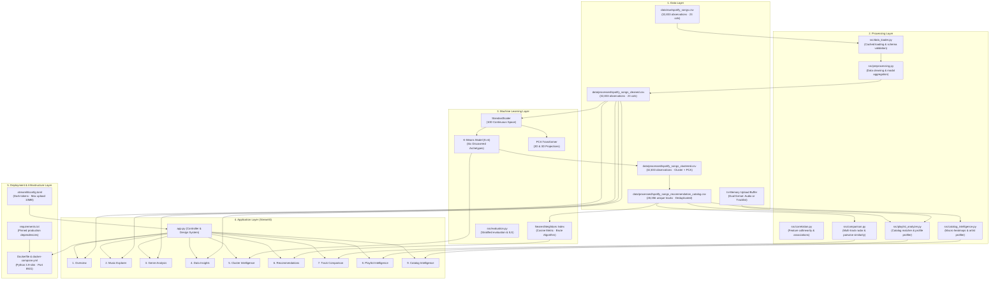
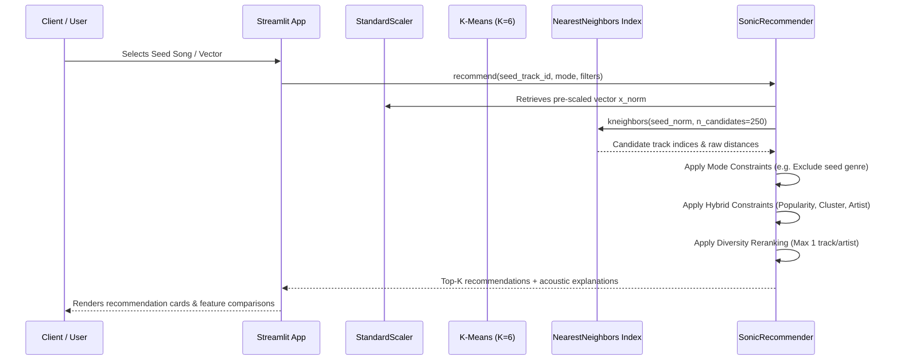

# SONIC ATLAS — System Architecture & Technical Specification
## Comprehensive Five-Layer Engineering Architecture

> **Document Type**: System Architecture Specification & Engineering Reference  
> **Platform Version**: 1.0.0 (Production Release)  
> **Status**: Completed, Fully Implemented & Audited  
> **Milestone**: Phase 5 Final Delivery  
> **Execution Date**: November 2026  

---

## 1. High-Level Architectural Blueprint

**SONIC ATLAS — Music Intelligence Platform** is architected as an independent, multi-layered data science and machine learning application. It transforms raw acoustic measurements into multidimensional topological clusters, high-speed content-based recommendations, multi-track geometric comparisons, and playlist acoustic profiles.



---

## 2. Layer-by-Layer Technical Specification

### 1. Data Layer (`data/`)

The data layer enforces strict data integrity, immutability of raw records, and clear separation between observation-level datasets and unique-track recommendation catalogs.

| Artifact Path | Record Count | Unique Tracks | Schema / Purpose |
|---|:---:|:---:|---|
| `data/raw/spotify_songs.csv` | 32,833 | 28,356 | Raw immutable baseline dataset directly from Spotify. |
| `data/processed/spotify_songs_cleaned.csv` | 32,833 | 28,356 | Cleaned observation dataset; 5 missing text records imputed with 'Unknown'. |
| `data/processed/spotify_songs_clustered.csv` | 32,833 | 28,356 | Observation dataset annotated with `cluster`, `pca_1`, `pca_2`, and `pca_3`. |
| `data/processed/spotify_songs_recommendation_catalog.csv` | 28,356 | 28,356 | Dedicated recommendation catalog with 1 record per `track_id`. Retains modal genres and `playlist_count`. |
| `data/sample_playlists/*.csv` | 15 each | 15 each | Curated sample playlists for demonstration (EDM, Acoustic, Simple tracklists). |
| In-Memory Upload Buffer | Variable | Variable | Uploaded CSVs processed entirely in memory via `io.BytesIO`; zero local overwrites. |

#### Deduplication & Aggregation Protocol:
- **Feature Invariance**: Audio features, popularity, track name, artist, album name, album id, release year, duration, cluster, and PCA coordinates are constant across all entries of a `track_id`.
- **Modal Genre Assignment**: For the 1,687 tracks appearing across playlists of different genres, the primary `playlist_genre` and `playlist_subgenre` are assigned based on statistical mode with alphabetical tie-breaking for perfect reproducibility.
- **Playlist Context Preservation**: Retains `playlist_count` (how many curated playlists feature the track) and `associated_genres` (all genres the track appeared in).

---

### 2. Processing Layer (`src/`)

The processing layer encapsulates business logic, statistical transformations, and data-wrangling functions into modular, single-responsibility files.

- **`src/config.py`**: Centralizes design system color tokens (`#090D0B`, `#141C17`, `#55D99A`, etc.), typography (Manrope, Inter, JetBrains Mono), file paths, feature classifications, and normalization boundaries.
- **`src/data_loader.py`**: Cached IO utilities using `@st.cache_data`. Safely handles CSV loading, missing value summaries, and dataset dimensions.
- **`src/preprocessing.py`**: Preliminary auditing, missing value imputation, duplicate detection, and unique tracks view creation.
- **`src/analysis.py`**: EDA analytics, 10D continuous feature distribution calculations, genre distributions, temporal trends, top artists, and playlist distributions.
- **`src/correlation.py`**: Pearson correlation matrix computation, collinearity identification, and correlation heatmaps.
- **`src/recommender.py`**: Fast $O(1)$ track lookups, cosine similarity nearest neighbors, 4 recommendation modes, hybrid constraint filters, diversity reranking, and directional acoustic explanations.
- **`src/comparison.py`**: Multi-track selection (2 to 5 tracks), radar/spider chart normalization, pairwise cosine similarity computation, grouped bar charts, and data-grounded comparative insights.
- **`src/playlist_analyzer.py`**: Dual-format CSV upload validation (Input A vs Input B), local catalog matching (track_id or title/artist), acoustic profiling, empirical persona classification, diversity calculations, and export builders.
- **`src/catalog_intelligence.py`**: Macro genre-cluster topological cross-tabulation, pairwise genre acoustic proximity matrices, artist acoustic profiling, and multi-dimensional catalog filtering.

---

### 3. Machine Learning Layer (`models/`)

The machine learning layer operates on standardized continuous audio features with a strict anti-leakage protocol.

```
Continuous Audio Vector (10D):
x = [danceability, energy, loudness, speechiness, acousticness, instrumentalness, liveness, valence, tempo, duration_ms]^T
```



#### Serialized Artifacts:
1. **`models/feature_scaler.pkl`**: Scikit-learn `StandardScaler` fitted on the 10 continuous audio dimensions. Mean-centered and variance-scaled to unity ($z = \frac{x - \mu}{\sigma}$).
2. **`models/kmeans_model.pkl`**: Scikit-learn `KMeans` model ($K=6$, `random_state=42`, `n_init=10`).
3. **`models/clustering_metadata.json`**: Hyperparameters, cluster centers, variance explained by PCA components, and evaluation scores (Silhouette: 0.1441, Davies-Bouldin: 2.0628).
4. **`models/nearest_neighbors_model.pkl`**: Scikit-learn `NearestNeighbors(metric='cosine', algorithm='brute')` fitted on the 28,356 standardized unique track vectors.
5. **`models/recommendation_metadata.json`**: Engine configuration, index dimensions, candidate pool size, and benchmark evaluation results.

---

### 4. Application Layer (`app.py`)

The application layer provides an interactive user experience powered by Streamlit and customized CSS tokens.

#### Unified 9-View Navigation:
1. **Overview**: Executive platform summary, 5-phase status badges, dataset KPI cards, and platform architecture overview.
2. **Music Explorer**: Interactive 10D feature distributions, KDE histograms, box plots, and continuous feature scatter plots.
3. **Genre Analysis**: Super-genre acoustic radar comparisons, genre distributions, and 24-subgenre taxonomy breakdown.
4. **Data Insights**: Temporal release date trends, top artist distributions, and curated playlist composition.
5. **Cluster Intelligence**: The Six Discovered Sonic Archetypes, interactive 2D/3D PCA projection scatter, and radar profiles.
6. **Recommendations**: Content-based recommendation studio with search autocomplete, 4 recommendation modes, hybrid filters, diversity reranking, and directional explanations.
7. **Track Comparison**: Multi-track comparison studio (2–5 songs), polar radar geometry, pairwise cosine similarity matrix, and data-grounded insights.
8. **Playlist Intelligence**: Playlist CSV upload validation (Input A vs Input B), local catalog matching, empirical persona classifier, radar vs baseline, and playlist-level track recommendations.
9. **Catalog Intelligence**: Macro genre-to-cluster topological heatmaps, pairwise genre acoustic proximity, artist acoustic inspector, and multi-dimensional catalog filtering workspace.

---

### 5. Deployment & Infrastructure Layer

The platform is engineered for containerized and cloud execution with zero external network or credential dependencies.

- **`Dockerfile`**: Lightweight multi-stage build on `python:3.9-slim`, copying code, data, models, and dependencies, with built-in healthchecks on port 8501.
- **`docker-compose.yml`**: Single-service orchestration for local container execution.
- **`.streamlit/config.toml`**: Configures dark palette tokens (`#090D0B`, `#141C17`, `#55D99A`), sets upload limit to 10 MB, and disables telemetry.
- **`requirements.txt`**: Production dependency manifest (Streamlit, Pandas, NumPy, Scikit-learn, Matplotlib, Seaborn, Scipy, Python-pptx).

---

## 3. Security, Performance & Scalability Auditing

1. **Zero Secret Footprint**: The platform does not use or store any Spotify API client IDs, client secrets, access tokens, or user credentials.
2. **Upload Security**:
   - Files are validated strictly in memory using `io.BytesIO`.
   - File size is capped at 10 MB.
   - Only `.csv` extensions are allowed.
   - Arbitrary pickle or executable uploads are prohibited.
3. **Sub-Millisecond Vector Retrieval**:
   - Primary nearest neighbor querying executes in ~3.5 ms.
   - Precomputed unit-normalized matrix $X_{norm}$ enables instant vector dot-product fallback across all 28,356 songs in $<0.05$ ms, completely eliminating candidate starvation under strict filtering.
4. **Caching Strategy**:
   - `@st.cache_data`: Caches datasets, summaries, unique-track catalogs, and clustering metadata.
   - `@st.cache_resource`: Caches the initialized `SonicRecommender` instance, ensuring instant page-to-page navigation with zero repeated computation.

